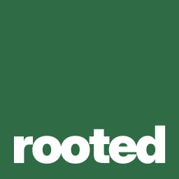
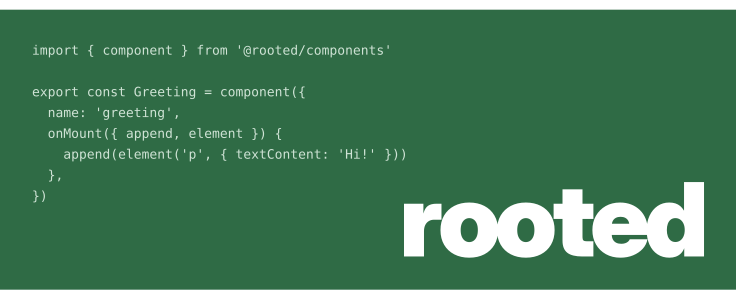
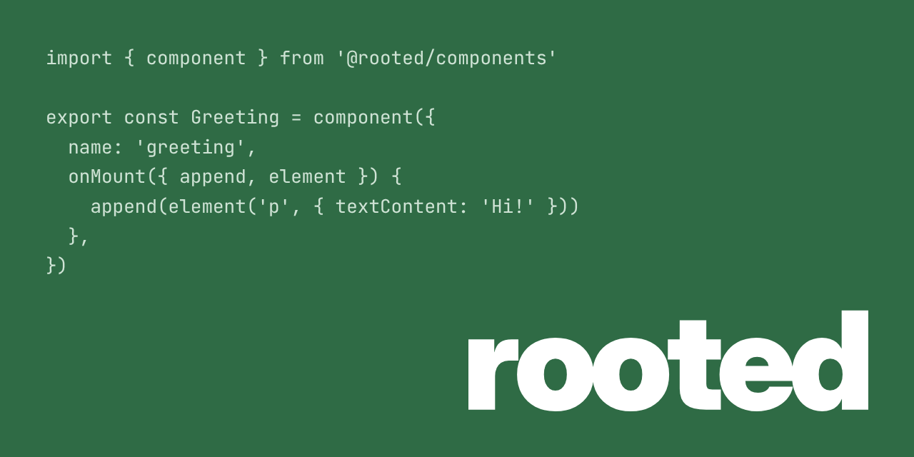

# Style guide

How rooted looks wherever it shows up: READMEs, docs, social previews, favicons. The brand is deliberately simple: a green square with the name in it, with nothing else added.

---

## Contents

- [Name](#name)
- [Logo](#logo)
- [Colour](#colour)
- [Typography](#typography)
- [Banners and social previews](#banners-and-social-previews)
- [Favicons and app icons](#favicons-and-app-icons)
- [Don'ts](#donts)
- [Files](#files)

---

## Name

The name is always written **lowercase**: `rooted`, never `Rooted` or `ROOTED`. This applies in the logo, in headings and in running text. Package names follow the same rule: `@rooted/components`, `@rooted/router`.

---

## Logo

The logo is a green square with `rooted` set in the bottom-right corner. At small sizes the full name stops being readable, so the logo has three tiers. Each tier replaces the previous one when that one becomes illegible:

| Tier | File | Use at | Content |
|------|------|--------|---------|
| 1 | [`logo.svg`](./logo.svg) | 64 px and up | `rooted`, bottom-right |
| 2 | [`logo-rd.svg`](./logo-rd.svg) | 32–48 px | a large `r` with a small `d` tucked under its arm |
| 3 | [`logo-r-dot.svg`](./logo-r-dot.svg) | 16–24 px | the large `r` with a dot where the `d` was |

<p>
  
  &nbsp;
  
  &nbsp;
  
</p>

All three tiers share the same tile, the same bottom-right anchor and the same colours. Pick the tier by the size it is **rendered** at, not by the size of the source file.

### Construction

All measurements are on the 256 × 256 tile.

| Element | Tier 1 | Tier 2 | Tier 3 |
|---------|--------|--------|--------|
| Tile | full square, square corners, `#2f6b45` | same | same |
| Main glyph | `rooted`, 216 wide, right edge at x 236, bottom at y 234 | `r`, 184 tall, left edge at x 40, baseline at y 226 | same `r` |
| Corner glyph | none | `d`, 80 tall, right edge at x 232, baseline at y 226 | dot, radius 29.3, touching x 232 and y 226 |

The margin around the wordmark is roughly 8 % of the tile on the right and the bottom. Keep it when scaling. The glyphs are outlines (paths), not live text, so the logo renders the same everywhere.

### Clear space

Keep at least **1/8 of the tile's width** free around the tile. Don't put other elements inside the tile.

---

## Colour

| Name | Hex | Use |
|------|-----|-----|
| rooted green | `#2f6b45` | the tile, banner backgrounds |
| white | `#ffffff` | the wordmark and glyphs on green |
| mist | `#cfe3d5` | secondary text and code on green (taglines, banner snippets) |
| night | `#0d1117` | dark backgrounds the logo sits on, body text on white, banner text in dark mode |

Contrast (WCAG 2.x):

| Foreground | Background | Ratio | Notes |
|------------|------------|-------|-------|
| white | rooted green | 6.34 : 1 | AA for all text |
| mist | rooted green | 4.71 : 1 | AA for normal text; use it for secondary text only |
| rooted green | white | 6.34 : 1 | green text or links on white are fine |
| rooted green | night | 2.98 : 1 | the tile edge is soft on dark backgrounds; the white glyphs carry the logo, so no outline is needed |

Use one green. No gradients, shadows or tints of the tile.

---

## Typography

| Role | Typeface | Weight | Notes |
|------|----------|--------|-------|
| Wordmark and logo glyphs | [Inter](https://rsms.me/inter/) | Black (900) | tight letter spacing; always outlined in the logo files |
| Code, taglines, technical labels | [JetBrains Mono](https://www.jetbrains.com/lp/mono/) | Regular (400) | |

Both typefaces are licensed under the SIL Open Font License, so they can be used freely, including outlined in a logo.

---

## Banners and social previews

Banners are the tile, stretched: a green field with `rooted` in the bottom-right corner and a short, real code example in the top-left.

### README banner



[`banner.svg`](./banner.svg) is 340 px high and takes the full width it's given. The code stays anchored to the top-left and the wordmark to the bottom-right, however wide the banner gets. Narrower than that, it adapts in steps:

| Image width | Layout |
|-------------|--------|
| 760 px and up | code and wordmark at full size |
| 690 to 759 px | both at 90 % |
| 610 to 689 px | both at 80 %, about what a phone in landscape gets |
| under 610 px | the code hides and the wordmark takes the proportions of the logo tile, with even margins |

The steps are media queries inside the SVG, which see the size of the image rather than of the page, so they work wherever the image is shown at its given size.

In dark mode the wordmark turns night (`#0d1117`) and the code switches to the dark palette below, so the banner doesn't glare on a dark page. This follows the browser or operating system setting (`prefers-color-scheme`). On GitHub that matches the site theme for anyone using the default "sync with system", but not for someone who picked a fixed GitHub theme that differs from their system. Dark text on green has less contrast than light text on green, so in dark mode the code reads more as texture than as something to read.

It only stretches when the image is told to, so always embed it with `width="100%"`. Give it `height="340"` as well, so the page doesn't shift once the image loads:

```html

```

| Element | Value |
|---------|-------|
| Height | 340 px |
| Margin | 32 px |
| Wordmark | 300 px wide, bottom-right |
| Code | 15 px JetBrains Mono, line height 1.45, top-left |

### Social preview



[`social-card.svg`](./social-card.svg) is the vector version and [`social-card.png`](./social-card.png) is what you upload: GitHub only takes PNG, JPG or GIF for the social preview, under **Settings → General → Social preview**. GitHub doesn't read it from the repository, so after changing it, upload the PNG again.

| Element | Value |
|---------|-------|
| Size | 1280 × 640 px |
| Margin | 56 px |
| Wordmark | 560 px wide, bottom-right |
| Code | 22 px JetBrains Mono, line height 1.45, top-left |

### The code example

- It is **real** rooted code, written the way the codebase writes it: tabs, one property per line, options types declared on their own.
- It reads as a plain component, not a joke or a feature demo. It's there to show what rooted code looks like, not to be read line by line.
- It starts in the top-left and is allowed to run off the bottom edge. The lines that end up next to the wordmark should be short (closing brackets, nested properties), so they don't run into it.
- It's set in JetBrains Mono with the syntax colours below.

| Token | Class | Light | Dark |
|-------|-------|-------|------|
| Keywords (`import`, `type`, `export`, `const`) | `keyword` | `#ffffff` | `#0d1117` |
| Strings | `string` | `#f3d59a` | `#3d2600` |
| Function calls (`component`, `element`, ...) | `function` | `#dcf29b` | `#2c3a00` |
| Types | `type` | `#a9d8ff` | `#0b2a4a` |
| Property names | `property` | `#cfe3d5` | `#12241a` |
| Punctuation | `punctuation` | `#9fc4ab` | `#1c3d29` |
| Everything else | `plain` | `#cfe3d5` | `#0d1117` |

The banner and the social preview are generated by [`@rooted/branding`](../../tooling/branding/readme.md). To change the code, edit `tooling/branding/src/banners/code-example.mts` and run:

```sh
pnpm branding banners
```

That rewrites `banner.svg`, `social-card.svg` and `social-card.png`. Don't edit those files by hand, the next run overwrites them. Both the wordmark and the code are outlines, not live text, so they look the same everywhere without any font installed. The colours come from `tooling/branding/src/banners/palette.mts` and match the table above. After regenerating, upload `social-card.png` to GitHub again.

---

## Favicons and app icons

| Asset | Tier | Sizes |
|-------|------|-------|
| `favicon.ico` | tier 3 at 16 px, tier 2 at 32 and 48 px | 16, 32, 48 |
| `favicon.svg` (optional) | tier 3 | scalable |
| `apple-touch-icon.png` | tier 1 | 180 |
| Web app manifest icons | tier 1 | 192, 512 |
| GitHub / npm avatar | tier 1 | as uploaded |

A single SVG favicon can't switch tiers by size, and browsers that support SVG favicons prefer it over the `.ico` in tabs. If you ship `favicon.svg`, make it tier 3. Otherwise, leave it out and let the `.ico` choose.

```html
<link rel="icon" href="/favicon.ico" sizes="16x16 32x32 48x48">
<link rel="icon" href="/favicon.svg" type="image/svg+xml">
<link rel="apple-touch-icon" href="/apple-touch-icon.png">
<link rel="manifest" href="/manifest.webmanifest">
```

---

## Don'ts

- Don't capitalise the name, in the logo or anywhere else.
- Don't move the wordmark out of the bottom-right corner, or centre it.
- Don't recolour the tile, add gradients, shadows or outlines, or round the corners.
- Don't use a tier outside its size range. A tiny `rooted` is unreadable, and a huge `r.` loses the name.
- Don't add illustrations, mascots or icons to the tile.
- Don't stretch or distort the tile. Banners are a wider green field with the wordmark placed in it, not a stretched logo file.

---

## Files

| File | Contents |
|------|----------|
| [`logo.svg`](./logo.svg) | tier 1, `rooted` |
| [`logo-rd.svg`](./logo-rd.svg) | tier 2, `r` + `d` |
| [`logo-r-dot.svg`](./logo-r-dot.svg) | tier 3, `r` + dot |
| [`banner.svg`](./banner.svg) | README banner, full width |
| [`social-card.svg`](./social-card.svg) | social preview source, 1280 × 640 |
| [`social-card.png`](./social-card.png) | social preview to upload to GitHub |

These files are covered by the [asset license](./LICENSE.md), not by the MIT license of the code.
